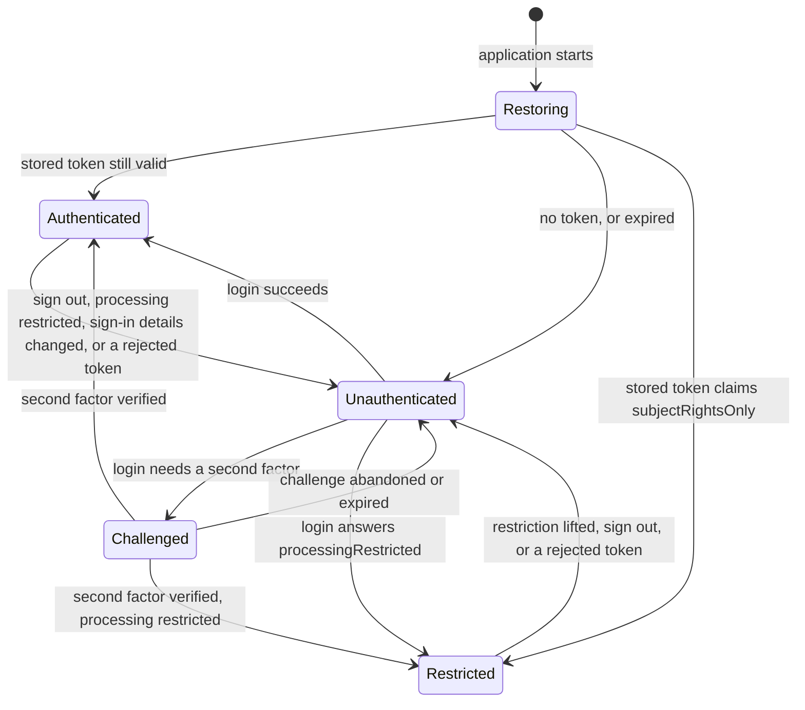
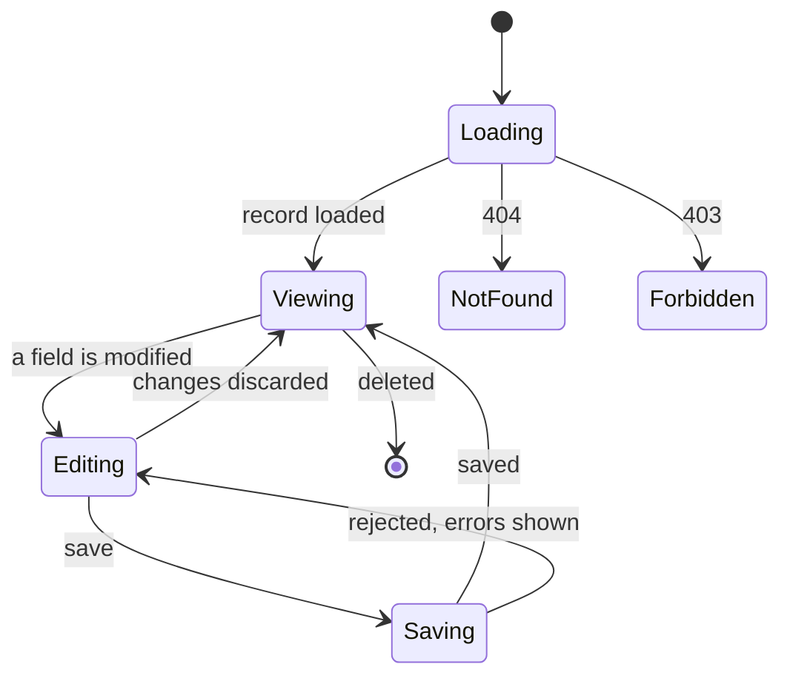

# Use Case Specification Document — Heimdall UI

## 1. Introduction

### 1.1 Purpose

This document specifies **what the Heimdall UI does**, use case by use case. Each use case describes
one coherent piece of work a user performs through the interface, with its main flow and every
alternative flow the implementation must handle.

The UI is a client of the [Heimdall API](https://github.com/artur-rios/heimdall-api). Each use case
carries a **Traces to** line naming the API use cases it consumes, so a change on either side can be
followed to the other. The mapping is deliberately not one-to-one: an API use case that only makes
sense alongside another (viewing and updating a record, for instance) becomes a single screen here,
and one API use case can serve several screens.

### 1.2 Actors

| Actor | Description |
| --- | --- |
| **System Admin** | Belongs to no scope; sees and manages every scope, person, application, permission, and Google user |
| **Scope Admin** | Owns one or more scopes; manages the users, applications, and permissions within them |
| **User** | Belongs to exactly one scope; manages only their own profile and security settings |
| **Anonymous** | An unauthenticated visitor; reaches only the public screens |
| **Restricted subject** | A person of any role, or a Google User, whose processing is restricted at their own request; signs in for their own data-protection rights only |
| **Heimdall API** | The external system that holds all identity data and enforces all authorization |
| **Google Identity Platform** | External system that authenticates a user and returns a signed ID token |

### 1.3 Use case overview

```mermaid
graph LR
    subgraph Actors
        SA(("System Admin"))
        SCA(("Scope Admin"))
        U(("User"))
        AN(("Anonymous"))
        RS(("Restricted subject"))
    end

    subgraph "Authentication & Session"
        UI01[UI-01: Login]
        UI02[UI-02: Two-factor challenge]
        UI03[UI-03: Request password recovery]
        UI04[UI-04: Reset password]
        UI05[UI-05: Verify email]
        UI06[UI-06: Google sign-in]
        UI07[UI-07: Route guarding]
        UI30[UI-30: Restricted session]
    end

    subgraph "Profile & Security"
        UI08[UI-08: Own profile]
        UI09[UI-09: Manage two-factor]
        UI33[UI-33: Restrict processing]
    end

    subgraph "Scope Management"
        UI10[UI-10: Browse scopes]
        UI11[UI-11: Create scope]
        UI12[UI-12: View & update scope]
        UI13[UI-13: Delete scope]
        UI14[UI-14: Manage scope owners]
        UI15[UI-15: Toggle Google Sign-In]
        UI31[UI-31: Sign-in & sign-up settings]
        UI35[UI-35: Pending registrations]
    end

    subgraph "Person Management"
        UI16[UI-16: Browse persons]
        UI17[UI-17: Create person]
        UI18[UI-18: View & update person]
        UI19[UI-19: Delete person]
        UI36[UI-36: Account emails]
        UI38[UI-38: List System Admins]
    end

    subgraph "Application Management"
        UI20[UI-20: Browse applications]
        UI21[UI-21: Create application]
        UI22[UI-22: View & update application]
        UI23[UI-23: Delete application]
        UI37[UI-37: Application credentials]
    end

    subgraph "Scope Permission Management"
        UI24[UI-24: Browse permissions]
        UI25[UI-25: Create permission]
        UI26[UI-26: View & update permission]
        UI27[UI-27: Delete permission]
    end

    subgraph "Data Subject Administration"
        UI32[UI-32: Erasure requests]
    end

    subgraph "Audit"
        UI34[UI-34: Review the audit trail]
    end

    subgraph "Google Users"
        UI28[UI-28: Browse & view Google users]
        UI29[UI-29: Delete Google user]
    end

    AN --> UI01 & UI02 & UI03 & UI04 & UI05 & UI06
    SA & SCA & U --> UI07 & UI08 & UI09 & UI33
    RS --> UI30
    SA --> UI10 & UI11 & UI12 & UI13 & UI14 & UI15 & UI31 & UI35
    SCA --> UI10 & UI12 & UI14 & UI15 & UI31 & UI35
    SA & SCA --> UI16 & UI17 & UI18 & UI19 & UI36
    SA --> UI38
    SA & SCA --> UI20 & UI21 & UI22 & UI23 & UI37
    SA & SCA --> UI24 & UI25 & UI26 & UI27
    SA & SCA --> UI28 & UI29
    SA --> UI32 & UI34
```

### 1.4 Inventory and traceability

| ID | Use case | Traces to |
| --- | --- | --- |
| UI-01 | Login | UC-11 |
| UI-02 | Complete two-factor challenge at login | UC-38, UC-46 |
| UI-03 | Request password recovery | UC-12 |
| UI-04 | Reset password | UC-13 |
| UI-05 | Verify email and resend verification | UC-14, UC-15 |
| UI-06 | Sign in and sign out with Google | UC-25, UC-26 |
| UI-07 | Guard routes by session and role | — |
| UI-08 | View and edit own profile | UC-07, UC-08, UC-27 |
| UI-09 | Manage two-factor authentication | UC-36, UC-37, UC-39, UC-40 |
| UI-10 | Browse and search scopes | UC-02 |
| UI-11 | Create a scope | UC-01 |
| UI-12 | View and update a scope | UC-02, UC-03 |
| UI-13 | Delete a scope, logically and permanently | UC-04, UC-05 |
| UI-14 | Manage scope owners | UC-21, UC-22, UC-23 |
| UI-15 | Toggle Google Sign-In for a scope | UC-24 |
| UI-16 | Browse and search persons in a scope | UC-07 |
| UI-17 | Create a person | UC-06 |
| UI-18 | View and update a person | UC-07, UC-08 |
| UI-19 | Delete a person, logically and permanently | UC-09, UC-10 |
| UI-20 | Browse applications in a scope | UC-17 |
| UI-21 | Create an application | UC-16 |
| UI-22 | View and update an application | UC-17, UC-18 |
| UI-23 | Delete an application, logically and permanently | UC-19, UC-20 |
| UI-24 | Browse scope permissions | UC-32 |
| UI-25 | Create a scope permission | UC-31 |
| UI-26 | View and update a scope permission | UC-32, UC-33 |
| UI-27 | Delete a scope permission, logically and permanently | UC-34, UC-35 |
| UI-28 | Browse and view Google users | UC-27 |
| UI-29 | Delete a Google user, logically and permanently | UC-28, UC-29 |
| UI-30 | Use a restricted session | UC-11 (AF-11i), UC-25 (AF-25e), UC-38, UC-41, UC-42, UC-45 |
| UI-31 | Configure a scope's sign-in and sign-up | UC-24, UC-47 |
| UI-32 | Review outstanding erasure requests | UC-43 |
| UI-33 | Restrict processing of my account | UC-44, UC-45 |
| UI-34 | Review the audit trail | UC-48 |
| UI-35 | Manage a scope's pending registrations | UC-49, UC-50 |
| UI-36 | Send account emails to a person | UC-51, UC-52 |
| UI-37 | Manage an application's credentials | UC-53, UC-54, UC-55 |
| UI-38 | List System Admins | UC-07 (read e) |

### 1.5 Platform items

These are not use cases. They carry no user-facing flow of their own, but they are tracked and
delivered the same way.

| ID | Item |
| --- | --- |
| P-01 | Project scaffolding and initial infrastructure |
| P-02 | Generated API client and specification drift check |
| P-03 | Multi-platform build and release pipelines |
| P-04 | API health and diagnostics screen (consumes UC-30) |

### 1.6 Conventions used below

- **Errors from the API** are the `errors` array of its response envelope. Wherever a flow says the
  client "shows the returned errors", it means those strings, attached to the offending field when
  the error names one and shown in a banner otherwise.
- **Client-side validation** never replaces the API's. It exists to avoid a pointless round trip, and
  the API remains the authority.
- **Every identifier** in a route or a request is a `PublicId` GUID.
- **A destructive action** is one that deletes. Every destructive action requires a confirmation
  dialog naming the record, and a permanent deletion additionally requires the user to type the
  record's name to enable the confirm button.

---

## 2. Use case specifications

---

### UI-01: Login

**Actor:** Anonymous
**Traces to:** UC-11 (Login)
**Precondition:** The application is configured with a reachable API base URL and no valid session exists.

**Main flow**

1. The user opens the application and is redirected to the login screen.
2. The user enters an email address and a password.
3. The user submits the form.
4. The client calls `POST /api/auth/login` with the email, the password, and the configured scope. The
   scope is the one the calling application named, or the build's own; without one the API finds only
   administrators, because a User's email is unique only within their scope.
5. The API answers with a token and its expiry.
6. The client stores the token, establishes the session, and redirects to the screen the user
   originally requested, or to the home screen.

**Alternative flows**

- **AF-01a — Invalid credentials.** The API answers unsuccessfully. The client shows the returned
  errors above the form, keeps the email, and clears the password.
- **AF-01b — Client-side validation fails.** An empty or malformed email, or an empty password,
  blocks submission and marks the offending field. No request is made.
- **AF-01c — Two-factor required.** The response carries `requiresTwoFactor`, a `challengeToken`,
  and `availableMethods`. The client moves the session to `challenged` and routes to UI-02 instead
  of establishing a session.
- **AF-01d — API unreachable.** A transport failure or timeout shows a retryable banner; no session
  state changes.
- **AF-01e — Google Sign-In offered.** The login screen also presents the Google sign-in control
  described in UI-06.

---

### UI-02: Complete two-factor challenge at login

**Actor:** Anonymous (holding a challenge)
**Traces to:** UC-38 (Verify Second Factor), UC-46 (Resend Second-Factor Email Code)
**Precondition:** The session is in the `challenged` state with a challenge token and a list of available methods.

**Main flow**

1. The client shows the challenge screen, naming the method in use.
2. The user enters the code from their authenticator application, from the email the API sent, or a
   recovery code.
3. While the method in use is email and no recovery code is being entered, the user may choose
   **Send a new code**. The client calls `POST /api/auth/2fa/challenge/resend` with the challenge
   token and shows "If your sign-in is still open, a new code is on its way. Codes sent before it no
   longer work." The button is disabled for 30 seconds, counting down in its label, and a challenge
   allows three sends. The code the user typed is kept.
4. The client calls `POST /api/auth/2fa/verify` with the challenge token and the code.
5. The API answers with a token and its expiry.
6. The client stores the token, establishes the session, and redirects onward.

**Alternative flows**

- **AF-02a — Wrong code.** The API answers unsuccessfully. The client shows the returned errors,
  clears the code field, and keeps the challenge alive.
- **AF-02b — Challenge expired or rejected.** The API answers with an expired or invalid challenge.
  The client discards the challenge, returns to UI-01, and explains that the sign-in must restart.
- **AF-02c — More than one method available.** When `availableMethods` holds more than one entry the
  user may switch between them; the chosen method is remembered for the duration of the challenge.
- **AF-02d — Recovery code used.** The user enters a recovery code instead of a generated one. On
  success the client reminds them that the code is now spent, and points at UI-09.
- **AF-02e — Abandoned challenge.** The user leaves the screen. The challenge token is discarded and
  the session returns to unauthenticated; it is never persisted.
- **AF-02f — No resend control.** The method in use is the authenticator app, or a recovery code is
  being entered. The client shows no **Send a new code** button.
- **AF-02g — Third send made.** After the third send for the challenge, **Send a new code** is
  replaced by **Start over** and the note "For another code, sign in again." Choosing **Start over**
  discards the challenge and returns to UI-01.
- **AF-02h — Transport or server failure.** The client shows an error banner. The send is not
  counted and the countdown does not start.
- **AF-02i — Send rate limited.** The API answers `429` with `Retry-After`. The client shows the
  message; the send is not counted, and **Send a new code** counts the `Retry-After` wait down in
  its label instead of the usual 30 seconds: in seconds under a minute ("Send a new code (45s)"),
  then in the minutes or hours the banner names ("Send a new code (24 hours)"), held to a day.

---

### UI-03: Request password recovery

**Actor:** Anonymous
**Traces to:** UC-12 (Password Recovery)
**Precondition:** None.

**Main flow**

1. The user opens the password recovery screen from the login screen.
2. The user enters their email address.
3. The client calls `POST /api/auth/password-recovery`.
4. The client shows the same neutral confirmation regardless of whether the address exists, telling
   the user to check their inbox.

**Alternative flows**

- **AF-03a — Client-side validation fails.** An empty or malformed address blocks submission.
- **AF-03b — API unreachable.** A transport failure shows a retryable banner. The confirmation is
  not shown, since nothing was sent.
- **AF-03c — Repeated submission.** The submit control is disabled while a request is in flight, so
  a double tap cannot send twice.

> The neutral confirmation is deliberate: the interface must not reveal whether an address is
> registered.

---

### UI-04: Reset password

**Actor:** Anonymous
**Traces to:** UC-13 (Reset Password)
**Precondition:** The user holds a reset token, normally arriving as a link that opens the application at `/password-reset?token=…`.

**Main flow**

1. The client opens the reset screen with the token from the link. On the web it takes the token out
   of the address bar as the application starts, so the history entry no longer holds it and no request
   the application makes afterwards carries it in its Referer.
2. The user enters a new password and confirms it.
3. The client calls `POST /api/auth/password-reset` with the token and the new password.
4. The API confirms. The client shows a success message and offers to sign in.

**Alternative flows**

- **AF-04a — Missing token.** The screen opens without a token. The client explains that the link is
  incomplete and offers UI-03. On the web this includes a reload of the page after the link was
  opened: the token was kept only in memory, so the link is opened again.
- **AF-04b — Invalid or expired token.** The API rejects it. The client shows the returned errors
  and offers UI-03.
- **AF-04c — Passwords do not match.** Client-side validation blocks submission and marks the
  confirmation field.
- **AF-04d — Password rejected by policy.** The API answers unsuccessfully. The client shows the
  returned errors against the password field.

---

### UI-05: Verify email and resend verification

**Actor:** Anonymous, or any authenticated actor
**Traces to:** UC-14 (Email Verification), UC-15 (Resend Verification Email)
**Precondition:** For verification, the user holds a verification token, normally arriving as a link that opens the application at `/verify-email?token=…`.

**Main flow**

1. The client opens the verification screen with the token from the link, taken out of the address
   bar on the web as in UI-04.
2. The client calls `POST /api/auth/verify-email` immediately, showing progress.
3. The API confirms. The client shows a success message and routes onward — to the home screen when
   a session exists, and to login otherwise.

**Alternative flows**

- **AF-05a — Missing token.** The screen opens without a token and offers the resend action instead.
- **AF-05b — Invalid or expired token.** The API rejects it. The client shows the returned errors
  and offers the resend action.
- **AF-05c — Resend requested.** The user asks for a new email. The client calls
  `POST /api/auth/resend-verification` and shows a neutral confirmation.
- **AF-05d — Already verified.** The API reports the address as already verified. The client treats
  this as success and says so plainly.
- **AF-05e — Unverified session banner.** An authenticated user whose address is unverified sees a
  dismissible banner on the home screen offering the resend action.
- **AF-05f — Resend held back.** The API answers `429`: "An email of this kind was sent to you
  recently. Try again in a few minutes." inside the account-email cooldown, a daily-limit message
  once the day's account emails are spent, or "Too many requests." from the rate limit. The client
  shows the message, keeps the session, and disables the resend action for the `Retry-After`
  seconds the answer carries.

---

### UI-06: Sign in and sign out with Google

**Actor:** Anonymous, Google User
**Traces to:** UC-25 (Sign Up / Sign In via Google), UC-26 (Sign Out via Google)
**Precondition:** The build is configured with a Google client id, and the target scope has Google Sign-In enabled.

**Main flow**

1. The login screen shows a Google sign-in control alongside the credentials form.
2. The user activates it and completes Google's own flow.
3. Google returns a signed ID token to the client.
4. The client calls `POST /api/auth/google` with the ID token and the target scope.
5. The API answers with a Heimdall token and its expiry.
6. The client stores the token, establishes the session, and redirects onward.

**Sign out**

1. A Google-authenticated user signs out.
2. The client calls `POST /api/auth/google/sign-out`, clears the local Google session, discards the
   token, and returns to the login screen. The API call and Google's sign-out are best-effort: when
   either fails, throws, or does not answer within a few seconds, the token is still discarded and
   the session still ends.

**Alternative flows**

- **AF-06a — Not configured.** No Google client id is present in the build. The control is hidden
  entirely rather than shown as broken.
- **AF-06b — Google Sign-In disabled for the scope.** The API rejects the exchange. The client shows
  the returned errors and leaves the credentials form available.
- **AF-06c — User cancels Google's flow.** No request is made and the login screen is unchanged.
- **AF-06d — Exchange rejected.** The API rejects the ID token. The client shows the returned errors
  and clears the pending Google session; if clearing it fails, the errors are shown all the same.
- **AF-06e — Platform without support.** On a target where the Google flow is unavailable the
  control is hidden, and the credentials form remains the only route in.
- **AF-06f — Unverified Google address.** On a first sign-up the API creates no Google User from
  an address Google has not verified, and answers `403` "Google sign-up requires a verified email
  address.". The client shows it as a sign-in error, as in AF-06d; no session existed, so nothing
  is said to have expired.
- **AF-06g — No nonce yet.** `POST /api/auth/google` accepts an optional `nonce`, which the client
  does not send yet: the Google Sign-In library takes a nonce only once, when it is initialised for
  the life of the application, so each sign-in cannot be given a fresh one. Sending a nonce is a
  planned improvement.

---

### UI-07: Guard routes by session and role

**Actor:** All
**Traces to:** — (cross-cutting; enforces the API's authorization matrix in the interface)
**Precondition:** None.

**Main flow**

1. A caller requests a route, by navigation or by opening a URL directly.
2. The client classifies the route as public or private, and reads the session state.
3. An authenticated caller with a permitted role reaches the route.

**Alternative flows**

- **AF-07a — No session.** A private route redirects to login, carrying the requested location so
  the user lands there after signing in.
- **AF-07b — Challenge in progress.** Every route except the challenge screen redirects to it.
- **AF-07c — Session being restored.** While the stored token is read at start-up, no redirect is
  decided and a loading state is shown; a slow read must not bounce the user to login.
- **AF-07d — Role not permitted.** An authenticated caller requesting a route their role cannot use
  is shown a "not available for your role" screen, not a redirect loop.
- **AF-07e — Token rejected mid-session.** A `401` to a request made under the session clears it
  and redirects to login, explaining that the session ended — a token the API has revoked ("This
  token has been revoked. Sign in again.") included. A `401` that refuses a password or code typed
  into the request (AF-02a, AF-08h, AF-09d, AF-09f) is not a rejected token, and leaves the session
  alone.
- **AF-07f — Already signed in.** An authenticated caller requesting login or the challenge screen
  is redirected to the home screen.
- **AF-07g — Expired stored token.** A token whose expiry has passed is discarded at start-up
  without contacting the API.
- **AF-07h — Restricted session.** A subject-rights-only session (UI-30), whatever its role, is
  redirected to the restricted session screen from every route but that screen and the privacy
  notice. A full session asking for the restricted session screen is redirected to the home screen.
- **AF-07i — Malformed id.** A route whose id is not a `PublicId` GUID is redirected to a "not
  found" screen, whatever the session, before any screen is built with it or any request is made.

---

### UI-08: View and edit own profile

**Actor:** System Admin, Scope Admin, User — a Google User included (AF-08f)
**Traces to:** UC-07 (View Person), UC-08 (Update Person); UC-27 (View Google User) for a Google
User's own record
**Precondition:** A session exists.

**Main flow**

1. The user opens their profile.
2. The client calls `GET /api/persons/{id}` for the signed-in person and shows name, email, role,
   verification status, and scope membership.
3. The user edits their name or email and saves. A new email address is confirmed first (AF-08g).
4. The client calls `PUT /api/persons/{id}` and shows the updated record. A new email address
   signs the user out instead (AF-08c).

**Alternative flows**

- **AF-08a — Client-side validation fails.** An empty name or a malformed email blocks submission,
  and so does a new email address without the confirmation AF-08g asks for.
- **AF-08b — Update rejected.** The API answers unsuccessfully, for instance because the email is
  already taken. The client shows the returned errors against the offending field and keeps the
  user's input.
- **AF-08c — Email changed.** Changing the address ends every session the person holds, the one
  that changed it included, and the API marks the address unverified again. On success the client
  signs the user out and the sign-in screen says "Your sign-in details changed. Sign in again." The
  user signs in with the new address, and UI-05's prompt then offers the resend. The API compares
  the trimmed addresses exactly, so a change of case alone is a change of address too.
- **AF-08d — Nothing changed.** Saving with no modification is a no-op; the save control stays
  disabled until a field actually differs.
- **AF-08e — Record unavailable.** The API answers `404`, meaning the person was deleted from under
  the session. The client signs the user out and explains why.
- **AF-08f — Signed in with Google.** A Google session (UI-06) belongs to a Google User, not a
  person, so `GET /api/persons/{id}` would answer `404` for it. The client instead calls
  `GET /api/scopes/{scopeId}/google-users/{id}` with the scope and identifier the token names —
  UC-27 admits a Google User reading their own record — and shows the name, the email, the picture
  (the initials when there is none), whether Google verified the address, and the scope. The record
  is read-only, with the note "Your name and email come from your Google account.": there is no
  **Edit** and no resend, because the API offers no way to change a Google User's name or email.
  **Security** (UI-09, which tells a Google User that two-factor authentication does not apply to
  them) and **Restrict processing of my account** (UI-33) are offered as for a person. A `404` is
  AF-08e: the Google User was deleted from under the session.
- **AF-08g — Confirming a new email address.** While the email field differs from the current
  address (compared exactly, once trimmed), the form asks for the **Current password**, and — when
  the person's two-factor authentication is on — a **Two-factor code**. No emailed code is sent
  while signed in, so the code field says "A code from your authenticator app, or a recovery code.";
  when email is the person's only method it says "Use one of your recovery codes." The method is
  read through `GET /api/auth/2fa` once an edit starts, and the field suggests nothing until that
  read finishes; when it cannot be read, the first wording is used. The client sends
  `currentPassword` and, when the factor is on, `twoFactorCode` with the update. A name-only edit
  asks for neither and sends neither. Cancelling the edit clears both fields.
- **AF-08h — Confirmation refused.** The API answers `401` with "The password or code is
  incorrect." (an older API: "The current password is incorrect." or "The code or recovery code is
  missing, incorrect, or already used."). The same answer covers a re-authentication the API has
  paused after repeated failures. The client shows the message above the form, keeps the input,
  and leaves the session alone: the token is still good, and the person is meant to correct what
  they typed.
- **AF-08i — Email method on.** While the person's email sign-in method is on, enabled or pending,
  the API refuses a change of address with `409` "Turn off the email sign-in method before changing
  your email address.". The client shows it above the form, keeps the input, and adds "Turn the
  email method off in your security settings, change your address, then set the method up again at
  the new one." with **Open security settings**, which opens UI-09 once the unsaved edit is let go.
- **AF-08j — Email held back.** The change's notice to the previous address counts against the
  account-email budget. The API answers `429` with a cooldown or daily-limit message and
  `Retry-After`; the client shows the message with how long to wait, keeps the input, and leaves
  the session alone.

---

### UI-09: Manage two-factor authentication

**Actor:** System Admin, Scope Admin, User
**Traces to:** UC-36 (Enable), UC-37 (Confirm Setup), UC-39 (Disable), UC-40 (Regenerate Recovery Codes)
**Precondition:** A session exists.

**Main flow — enabling**

1. The user opens the security section of their profile, which states whether two-factor
   authentication is on.
2. The user chooses a method, and the client asks for their current password.
3. The client calls `POST /api/auth/2fa/enable` with the method and `currentPassword`.
4. For an authenticator method the API returns an `otpAuthUri`; the client renders it as a QR code
   and also shows the secret as text for manual entry. For the email method the API reports that a
   code was sent.
5. The user enters the code from their authenticator or their inbox.
6. The client calls `POST /api/auth/2fa/confirm`.
7. The API confirms and returns the recovery codes. The client shows them once, offers to copy or
   download them, and requires the user to acknowledge before leaving.
8. Confirming ended every session the person holds, so once they acknowledge the codes the client
   signs them out (AF-09g). They sign in again with their second factor (UI-02).

**Main flow — disabling**

1. The user chooses to turn two-factor authentication off and confirms.
2. The client calls `POST /api/auth/2fa/disable` with the current password and a second factor — a
   generated code or a recovery code. The API requires both, and refuses either alone.
3. Turning it off ended every session the person holds, so the client signs them out (AF-09g).

**Main flow — regenerating recovery codes**

1. The user asks for new recovery codes and confirms that the current ones stop working. While the
   feature is on, the section says that codes in the shorter `XXXX-XXXX` form still work but that
   new ones, `XXXX-XXXX-XXXX-XXXX`, are stronger; the API reports no flag for an older set, so the
   person recognises their own.
2. The client calls `POST /api/auth/2fa/recovery-codes/regenerate` and shows the new codes once,
   under the same acknowledgement rule.
3. Regenerating ended every session the person holds, so once they acknowledge the codes the client
   signs them out (AF-09g).

**Alternative flows**

- **AF-09a — Wrong confirmation code.** The API rejects it, with `401` "The password or code is
  incorrect." (an older API answers `400`). The client shows the returned errors, keeps the setup
  alive so the user can try again without restarting, and leaves the session alone.
- **AF-09b — Setup abandoned.** The user leaves before confirming. Two-factor authentication stays
  off, and the pending secret is discarded from client memory.
- **AF-09c — Recovery codes not acknowledged.** Leaving is stopped by a confirmation, since the
  codes are shown exactly once: by the screen's back control, the navigation, signing out, a system
  back, and — on the web — a browser Back or Forward or a typed address, which the route itself asks
  about. While the codes wait, closing or reloading the tab asks the browser to confirm too. Leaving
  anyway signs the user out, as acknowledging does (AF-09g). A session that ends meanwhile is not
  held behind the confirmation.
- **AF-09d — Disable or regeneration rejected.** The API rejects the credential with `401` "The
  password or code is incorrect." (an older API: "The current password is incorrect." or "The code
  or recovery code is missing, incorrect, or already used."). The client shows the returned errors,
  leaves the feature on, and leaves the session alone.
- **AF-09e — QR code cannot be rendered.** The client always shows the secret as selectable text
  next to the QR code, so a rendering failure never blocks setup.
- **AF-09f — Password refused when enabling.** The API answers `401` with "The password or code is
  incorrect." (an older API: "The current password is incorrect."). The password dialog stays open with the message in it, so the user types the password
  again there; the feature stays off and the session is left alone.
- **AF-09g — Signed out after a change.** After a confirmation (once the codes are acknowledged or
  left), a disable, or a regeneration (once the codes are acknowledged or left), the client asks
  nothing more under the session's token, signs the user out, and the sign-in screen says "Your
  sign-in details changed. Sign in again." The recovery codes screen says so before they get
  there.
- **AF-09h — Email method held back.** Starting the email method sends an email, which the API's
  account-email budget limits. It answers `429` with a cooldown or daily-limit message and
  `Retry-After`. The password dialog stays open with the message and how long to wait, and its
  **Continue** is disabled for that long; the feature stays off and the session is left alone.

---

### UI-10: Browse and search scopes

**Actor:** System Admin, Scope Admin
**Traces to:** UC-02 (View Scope)
**Precondition:** A session exists.

**Main flow**

1. The user opens the scopes screen.
2. The client calls `GET /api/scopes` with the current page, page size, name filter, and the
   include-deleted flag.
3. The client shows the page — cards on a compact window, a table on an expanded one — with the
   name, description, Google Sign-In state, owner count, and deletion state of each scope.
4. The user pages, searches by name, or toggles whether deleted scopes are included.

**Alternative flows**

- **AF-10a — Empty result.** An empty-state panel distinguishes "no scopes yet", which offers
  UI-11, from "no matches", which offers to clear the filter.
- **AF-10b — Request fails.** An error panel shows the returned errors and offers a retry, keeping
  the current filters.
- **AF-10c — Scope Admin.** The listing returns only the scopes the signed-in admin owns; the
  create control is hidden, since only a System Admin may create a scope.
- **AF-10d — Filter changes reset paging.** Editing the search or the include-deleted flag returns
  to the first page.
- **AF-10e — Loading.** A placeholder occupies the list while the first page loads, so the layout
  does not jump.

---

### UI-11: Create a scope

**Actor:** System Admin
**Traces to:** UC-01 (Create Scope)
**Precondition:** A session exists whose role is System Admin.

**Main flow**

1. The user opens the create-scope form from the scopes screen.
2. The user enters a name and a description, and selects at least one owner — a Scope Admin, a
   System Admin, or themselves through **Add me**, which is what makes a first scope possible before
   any Scope Admin exists.
3. The client calls `POST /api/scopes`.
4. The API creates the scope. The client shows a confirmation and opens the new scope's detail.

**Alternative flows**

- **AF-11a — Client-side validation fails.** An empty name, or no owner selected, blocks submission,
  and the form says which: each refused field shows its message, and the first one is scrolled into
  view.
- **AF-11b — Name already exists.** The API answers unsuccessfully. The client shows the returned
  errors against the name field and keeps the rest of the form.
- **AF-11c — Owner rejected.** The API rejects an owner that is neither a Scope Admin nor a System
  Admin. The client shows
  the returned errors against the owner selector.
- **AF-11d — Cancelled with changes.** Leaving a modified form asks for confirmation first.
- **AF-11e — Request fails.** A transport failure leaves the form filled in and offers a retry.

---

### UI-12: View and update a scope

**Actor:** System Admin, Scope Admin
**Traces to:** UC-02 (View Scope), UC-03 (Update Scope)
**Precondition:** A session exists, and a Scope Admin may only open a scope they own.

**Main flow**

1. The user opens a scope from the listing, or by URL.
2. The client calls `GET /api/scopes/{id}` and shows the scope with its owners, a summary of its
   sign-in and sign-up settings, and an **In this scope** list linking to its persons, applications,
   permissions, Google users, and **Sign-in & sign-up** (UI-31).
3. The user edits the name or description and saves.
4. The client calls `PUT /api/scopes/{id}` and shows the updated record.

**Alternative flows**

- **AF-12a — Not found.** The API answers `404`. The client shows a not-found panel with a way back
  to the listing.
- **AF-12b — Forbidden.** The API answers `403`. The client shows the not-available-for-your-role
  panel described in UI-07.
- **AF-12c — Update rejected.** The API answers unsuccessfully, for instance on a duplicate name.
  The client shows the returned errors against the offending field.
- **AF-12d — Deleted scope.** A logically deleted scope is shown read-only, marked as deleted.
- **AF-12e — Nothing changed.** The save control stays disabled until a field actually differs.

---

### UI-13: Delete a scope, logically and permanently

**Actor:** System Admin
**Traces to:** UC-04 (Logical Delete Scope), UC-05 (Hard Delete Scope)
**Precondition:** A session exists whose role is System Admin, and the scope is open.

**Main flow — logical deletion**

1. The user chooses to delete the scope.
2. A confirmation dialog names the scope and explains that the record is kept and can be restored by
   the API.
3. The client calls `DELETE /api/scopes/{id}` and returns to the listing with a confirmation.

**Main flow — permanent deletion**

1. The user chooses to delete the scope permanently.
2. A confirmation dialog names the scope, states that the record and its contents are erased, and
   requires the scope's name to be typed before the confirm control is enabled.
3. The client calls `DELETE /api/scopes/{id}/hard` and returns to the listing with a confirmation.

**Alternative flows**

- **AF-13a — Cancelled.** The dialog closes and nothing is sent.
- **AF-13b — Rejected.** The API refuses, for instance because the scope still holds users. The
  client shows the returned errors and leaves the scope open.
- **AF-13c — Typed name does not match.** The confirm control stays disabled.
- **AF-13d — Already deleted.** The API answers `404`. The client treats it as done and returns to
  a refreshed listing.
- **AF-13e — Not permitted.** A Scope Admin never sees either control.

---

### UI-14: Manage scope owners

**Actor:** System Admin, Scope Admin
**Traces to:** UC-21 (Add Scope Owner), UC-22 (Remove Scope Owner), UC-23 (Promote User to Scope Owner)
**Precondition:** A session exists, and a Scope Admin may only manage the scopes they own.

**Main flow**

1. The user opens the owners section of a scope, which lists the current owners.
2. The client calls `GET /api/scopes/{scopeId}/owners`.
3. The user adds an existing Scope Admin (or, as a System Admin, a System Admin) as a co-owner, and
   the client calls
   `POST /api/scopes/{scopeId}/owners/{personId}`.
4. The user creates a brand-new Scope Admin as a co-owner, and the client calls
   `POST /api/scopes/{scopeId}/owners`.
5. The user promotes an existing user of the scope, and the client calls
   `POST /api/scopes/{scopeId}/users/{personId}/promote` after a confirmation explaining that the
   person stops being a user of the scope.
6. The user removes an owner, and the client calls
   `DELETE /api/scopes/{scopeId}/owners/{personId}` after a confirmation.

**Alternative flows**

- **AF-14a — Last owner.** The API refuses to remove the only owner. The client shows the returned
  errors; the remove control is disabled when the list holds a single owner.
- **AF-14b — Person is not a Scope Admin.** The API refuses. The client shows the returned errors
  against the selector.
- **AF-14c — Already an owner.** The API refuses a duplicate. The client shows the returned errors,
  and already-listed owners are excluded from the selector.
- **AF-14d — Creating a co-owner fails validation.** An empty name, a malformed email, or a rejected
  password shows the returned errors against the offending field.
- **AF-14e — Promotion cancelled.** The dialog closes and nothing is sent.
- **AF-14f — Removing yourself.** A Scope Admin removing their own ownership is warned that they
  lose access to the scope, and the listing refreshes accordingly afterwards.

---

### UI-15: Toggle Google Sign-In for a scope

**Actor:** System Admin, Scope Admin
**Traces to:** UC-24 (Enable/Disable Google Sign-In)
**Precondition:** A session exists, and a Scope Admin may only change a scope they own.

> Since UI-31, the switch lives on the scope's **Sign-in & sign-up** screen
> (`/scopes/:scopeId/sign-in-settings`) rather than on the scope detail. Its flows are unchanged.

**Main flow**

1. The **Sign-in & sign-up** screen (UI-31) shows a control reflecting the current `googleSignInEnabled` state.
2. The user toggles it.
3. The client calls `PUT /api/scopes/{id}/google-signin` with the new value.
4. The control settles on the confirmed state.

**Alternative flows**

- **AF-15a — Rejected.** The API refuses. The control returns to its previous state and the returned
  errors are shown.
- **AF-15b — Disabling with Google users present.** The confirmation explains that existing Google
  users can no longer sign in, before anything is sent.
- **AF-15c — In flight.** The control is disabled while the request is outstanding, so it cannot be
  toggled twice.

---

### UI-16: Browse and search persons in a scope

**Actor:** System Admin, Scope Admin
**Traces to:** UC-07 (View Person)
**Precondition:** A session exists, and a scope is selected.

**Main flow**

1. The user opens the persons screen of a scope.
2. The client calls `GET /api/scopes/{scopeId}/persons` with the page, page size, filters, and the
   include-deleted flag.
3. The client shows the page with each person's name, email, role, verification state, and deletion
   state.
4. The user pages, searches, or toggles whether deleted persons are included.

**Alternative flows**

- **AF-16a — Empty result.** The empty state distinguishes "no persons yet", offering UI-17, from
  "no matches", offering to clear the filter.
- **AF-16b — Request fails.** An error panel shows the returned errors and offers a retry.
- **AF-16c — Forbidden.** A Scope Admin opening a scope they do not own gets the
  not-available-for-your-role panel.
- **AF-16d — Filter changes reset paging.**

---

### UI-17: Create a person

**Actor:** System Admin, Scope Admin
**Traces to:** UC-06 (Create Person)
**Precondition:** A session exists, and a Scope Admin may only create within a scope they own.

**Main flow**

1. The user opens the create-person form.
2. The user enters a name, an email, a password, and a role.
3. The client calls `POST /api/scopes/{scopeId}/persons`, or `POST /api/persons` when a System Admin
   creates a person that belongs to no scope.
4. The API creates the person and sends the verification email. The client confirms and opens the
   new person's detail.

**Alternative flows**

- **AF-17a — Client-side validation fails.** An empty name, a malformed email, or an empty password
  blocks submission.
- **AF-17b — Email already registered.** The API answers unsuccessfully. The client shows the
  returned errors against the email field.
- **AF-17c — Password rejected by policy.** The client shows the returned errors against the
  password field.
- **AF-17d — Role not permitted.** A Scope Admin may not create a System Admin; that option is not
  offered, and a rejection from the API is shown as returned.
- **AF-17e — Cancelled with changes.** Leaving a modified form asks for confirmation first.
- **AF-17f — System Admin chosen.** Submitting with the System Admin role asks for confirmation first, saying the
  person will be able to administer every scope. Nothing is sent until it is accepted. The password field is marked
  as a new password, so a password manager does not offer the creator's own.
- **AF-17g — Too many requests.** Creating people with a password is rate limited. The API answers
  `429` "Too many requests." with `Retry-After`; the client shows it as an error with how long to
  wait, and keeps the form as typed. Creating a co-owner (UI-14) behaves the same way.

---

### UI-18: View and update a person

**Actor:** System Admin, Scope Admin
**Traces to:** UC-07 (View Person), UC-08 (Update Person)
**Precondition:** A session exists, and the person is within reach of the signed-in role.

**Main flow**

1. The user opens a person from the listing, or by URL.
2. The client calls `GET /api/persons/{id}` and shows the record with its role, scope membership,
   owned scopes, and verification state.
3. The user edits the name or email and saves.
4. The client calls `PUT /api/persons/{id}` and shows the updated record. Changing somebody else's
   address asks for no password: the request carries none, and the signed-in user's own session is
   unaffected.

**Alternative flows**

- **AF-18a — Not found.** The API answers `404`; a not-found panel offers a way back.
- **AF-18b — Forbidden.** The API answers `403`; the not-available-for-your-role panel is shown.
- **AF-18c — Update rejected.** The returned errors are shown against the offending field.
- **AF-18d — Deleted person.** A logically deleted person is shown read-only, marked as deleted.
- **AF-18e — Editing yourself.** Opening your own record from the administrative listing lets you
  change your name, never your role, and shows your email address read-only, with "Change your own
  email from your profile." beneath it while editing: changing it is done from your profile (UI-08),
  which asks for your password (AF-08g) and signs you in again.
- **AF-18f — Opened from the System Admins list.** A System Admin may also open a person at
  `/persons/:personId` from UI-38. The page is the same, without a scope: its back control (tooltip
  **Back to System Admins**) returns to the System Admins list, and so does a delete.

---

### UI-19: Delete a person, logically and permanently

**Actor:** System Admin, Scope Admin (logical only)
**Traces to:** UC-09 (Logical Delete Person), UC-10 (Hard Delete Person)
**Precondition:** A session exists and the person is open.

**Main flow — logical deletion**

1. The user chooses to delete the person and confirms in a dialog naming them.
2. The client calls `DELETE /api/persons/{id}` and returns to the listing with a confirmation.

**Main flow — permanent deletion**

1. A System Admin chooses to delete the person permanently.
2. The dialog names the person, states that the record is erased, and requires their email to be
   typed before the confirm control is enabled.
3. The client calls `DELETE /api/persons/{id}/hard` and returns to the listing.

**Alternative flows**

- **AF-19a — Cancelled.** Nothing is sent.
- **AF-19b — Rejected.** The API refuses, for instance for the last owner of a scope. The returned
  errors are shown and the person stays open.
- **AF-19c — Typed email does not match.** The confirm control stays disabled.
- **AF-19d — Deleting yourself.** The controls are disabled on your own record.
- **AF-19e — Not permitted.** A Scope Admin never sees the permanent deletion control.

---

### UI-20: Browse applications in a scope

**Actor:** System Admin, Scope Admin
**Traces to:** UC-17 (View Application)
**Precondition:** A session exists and a scope is selected.

**Main flow**

1. The user opens the applications screen of a scope.
2. The client calls `GET /api/scopes/{scopeId}/applications` with the page, page size, filters, and
   the include-deleted flag.
3. The client shows the page with each application's name, owner, and deletion state.
4. The user pages, searches, or toggles whether deleted applications are included.

**Alternative flows**

- **AF-20a — Empty result.** The empty state distinguishes "none yet", offering UI-21, from "no
  matches".
- **AF-20b — Request fails.** An error panel shows the returned errors and offers a retry.
- **AF-20c — Forbidden.** The not-available-for-your-role panel is shown.
- **AF-20d — Owner no longer resolvable.** An owner that cannot be resolved to a person is shown by
  its identifier rather than blanking the row.

---

### UI-21: Create an application

**Actor:** System Admin, Scope Admin
**Traces to:** UC-16 (Create Application)
**Precondition:** A session exists, and a Scope Admin may only create within a scope they own.

**Main flow**

1. The user opens the create-application form.
2. The user enters a name and selects an owner from the persons associated with the scope.
3. The client calls `POST /api/scopes/{scopeId}/applications`.
4. The API creates the application. The client confirms and opens its detail.

**Alternative flows**

- **AF-21a — Client-side validation fails.** An empty name, or no owner selected, blocks submission.
- **AF-21b — Name already exists in the scope.** The returned errors are shown against the name.
- **AF-21c — Owner not associated with the scope.** The API refuses; the returned errors are shown
  against the owner selector, which lists only persons of that scope.
- **AF-21d — Cancelled with changes.** Leaving a modified form asks for confirmation first.

---

### UI-22: View and update an application

**Actor:** System Admin, Scope Admin
**Traces to:** UC-17 (View Application), UC-18 (Update Application)
**Precondition:** A session exists and the application is within reach of the signed-in role.

**Main flow**

1. The user opens an application from the listing, or by URL.
2. The client calls `GET /api/scopes/{scopeId}/applications/{id}` and shows it with its owner.
3. The user edits the name or the owner and saves.
4. The client calls `PUT /api/scopes/{scopeId}/applications/{id}` and shows the updated record.

**Alternative flows**

- **AF-22a — Not found.** A not-found panel offers a way back.
- **AF-22b — Forbidden.** The not-available-for-your-role panel is shown.
- **AF-22c — Update rejected.** The returned errors are shown against the offending field.
- **AF-22d — Deleted application.** Shown read-only, marked as deleted.
- **AF-22e — Nothing changed.** The save control stays disabled until a field differs.

---

### UI-23: Delete an application, logically and permanently

**Actor:** System Admin, Scope Admin (logical only)
**Traces to:** UC-19 (Logical Delete Application), UC-20 (Hard Delete Application)
**Precondition:** A session exists and the application is open.

**Main flow — logical deletion**

1. The user chooses to delete the application and confirms in a dialog naming it.
2. The client calls `DELETE /api/scopes/{scopeId}/applications/{id}` and returns to the listing.

**Main flow — permanent deletion**

1. A System Admin chooses permanent deletion, and the dialog requires the application's name to be
   typed.
2. The client calls `DELETE /api/scopes/{scopeId}/applications/{id}/hard` and returns to the
   listing.

**Alternative flows**

- **AF-23a — Cancelled.** Nothing is sent.
- **AF-23b — Rejected.** The returned errors are shown and the application stays open.
- **AF-23c — Typed name does not match.** The confirm control stays disabled.
- **AF-23d — Not permitted.** A Scope Admin never sees the permanent deletion control.

---

### UI-24: Browse scope permissions

**Actor:** System Admin, Scope Admin
**Traces to:** UC-32 (View Scope Permission)
**Precondition:** A session exists and a scope is selected.

**Main flow**

1. The user opens the permissions screen of a scope.
2. The client calls `GET /api/scopes/{scopeId}/permissions` with the page, page size, filters, and
   the include-deleted flag.
3. The client shows each permission's name, description, whether it is included as a JWT claim, and
   its deletion state.

**Alternative flows**

- **AF-24a — Empty result.** The empty state distinguishes "none yet", offering UI-25, from "no
  matches".
- **AF-24b — Request fails.** An error panel shows the returned errors and offers a retry.
- **AF-24c — Forbidden.** The not-available-for-your-role panel is shown.

---

### UI-25: Create a scope permission

**Actor:** System Admin, Scope Admin
**Traces to:** UC-31 (Create Scope Permission)
**Precondition:** A session exists, and a Scope Admin may only create within a scope they own.

**Main flow**

1. The user opens the create-permission form.
2. The user enters a name and a description, and chooses whether it is included as a JWT claim.
3. The client calls `POST /api/scopes/{scopeId}/permissions`.
4. The API creates it. The client confirms and opens its detail.

**Alternative flows**

- **AF-25a — Client-side validation fails.** An empty name blocks submission.
- **AF-25b — Name already exists in the scope.** The returned errors are shown against the name.
- **AF-25c — Cancelled with changes.** Leaving a modified form asks for confirmation first.
- **AF-25d — Claim inclusion explained.** The form states plainly that including a permission as a
  claim puts it into the tokens the scope's users receive.

---

### UI-26: View and update a scope permission

**Actor:** System Admin, Scope Admin
**Traces to:** UC-32 (View Scope Permission), UC-33 (Update Scope Permission)
**Precondition:** A session exists and the permission is within reach of the signed-in role.

**Main flow**

1. The user opens a permission from the listing, or by URL.
2. The client calls `GET /api/scopes/{scopeId}/permissions/{id}`.
3. The user edits the name, the description, or the claim flag and saves.
4. The client calls `PUT /api/scopes/{scopeId}/permissions/{id}` and shows the updated record.

**Alternative flows**

- **AF-26a — Not found.** A not-found panel offers a way back.
- **AF-26b — Forbidden.** The not-available-for-your-role panel is shown.
- **AF-26c — Update rejected.** The returned errors are shown against the offending field.
- **AF-26d — Deleted permission.** Shown read-only, marked as deleted.
- **AF-26e — Claim flag changed.** The confirmation notes that tokens issued from then on carry the
  change, and tokens already issued do not.

---

### UI-27: Delete a scope permission, logically and permanently

**Actor:** System Admin, Scope Admin (logical only)
**Traces to:** UC-34 (Logical Delete Scope Permission), UC-35 (Hard Delete Scope Permission)
**Precondition:** A session exists and the permission is open.

**Main flow — logical deletion**

1. The user chooses to delete the permission and confirms in a dialog naming it.
2. The client calls `DELETE /api/scopes/{scopeId}/permissions/{id}` and returns to the listing.

**Main flow — permanent deletion**

1. A System Admin chooses permanent deletion, and the dialog requires the permission's name to be
   typed.
2. The client calls `DELETE /api/scopes/{scopeId}/permissions/{id}/hard` and returns to the listing.

**Alternative flows**

- **AF-27a — Cancelled.** Nothing is sent.
- **AF-27b — Rejected.** The returned errors are shown and the permission stays open.
- **AF-27c — Typed name does not match.** The confirm control stays disabled.
- **AF-27d — Not permitted.** A Scope Admin never sees the permanent deletion control.

---

### UI-28: Browse and view Google users

**Actor:** System Admin, Scope Admin
**Traces to:** UC-27 (View Google User)
**Precondition:** A session exists and a scope is selected.

**Main flow**

1. The user opens the Google users screen of a scope.
2. The client calls `GET /api/scopes/{scopeId}/google-users` with the page, page size, filters, and
   the include-deleted flag.
3. The client shows each Google user's name, email, verification state from Google, profile picture,
   and deletion state.
4. Opening one calls `GET /api/scopes/{scopeId}/google-users/{id}` and shows the full record.

**Alternative flows**

- **AF-28a — Empty result.** The empty state explains that Google users appear only after someone
  signs in with Google, and opens the **Sign-in & sign-up** screen (UI-31), where UI-15's switch lives, when the scope has the
  feature switched off.
- **AF-28b — Request fails.** An error panel shows the returned errors and offers a retry.
- **AF-28c — Forbidden.** The not-available-for-your-role panel is shown.
- **AF-28d — Picture unavailable.** A missing or unreachable picture falls back to an initials
  avatar; the row never breaks.
- **AF-28e — Read-only.** Google users are never editable through the interface, since their fields
  come from Google.

---

### UI-29: Delete a Google user, logically and permanently

**Actor:** System Admin, Scope Admin (logical only)
**Traces to:** UC-28 (Logical Delete Google User), UC-29 (Hard Delete Google User)
**Precondition:** A session exists and the Google user is open.

**Main flow — logical deletion**

1. The user chooses to delete the Google user and confirms in a dialog naming them.
2. The client calls `DELETE /api/scopes/{scopeId}/google-users/{id}` and returns to the listing.

**Main flow — permanent deletion**

1. A System Admin chooses permanent deletion, and the dialog requires the Google user's email to be
   typed.
2. The client calls `DELETE /api/scopes/{scopeId}/google-users/{id}/hard` and returns to the
   listing.

**Alternative flows**

- **AF-29a — Cancelled.** Nothing is sent.
- **AF-29b — Rejected.** The returned errors are shown and the record stays open.
- **AF-29c — Typed email does not match.** The confirm control stays disabled.
- **AF-29d — Not permitted.** A Scope Admin never sees the permanent deletion control.
- **AF-29e — Sign-in still possible.** The dialog explains that a deleted Google user can sign in
  again while the scope has Google Sign-In enabled, which is why UI-15 sits next to this action.

---

### UI-30: Use a restricted session

**Actor:** Restricted subject — a person of any role, or a Google User, whose processing is restricted
**Traces to:** UC-11 (Login, AF-11i), UC-25 (Sign Up / Sign In via Google, AF-25e), UC-38 (Verify
Second Factor), UC-41 (Export Own Personal Data), UC-42 (Request Erasure of Own Identity), UC-45
(Lift a Restriction on Processing)
**Precondition:** Processing of the signing-in identity is restricted at its subject's request
(the API's UC-44, NFR-24), through UI-33 or directly through the API.

The API answers such a sign-in with a **subject-rights-only token**: it names the person and their
role, claims no scope, and is admitted to data export, erasure, restriction and its lift — and
refused with `403` everywhere else, even after the restriction is lifted. Without this use case a
restricted person would land on the home screen and watch every request fail.

**Main flow**

1. The person signs in through UI-01 or UI-06 (and UI-02 when a second factor is configured).
2. The API answers with a token and `processingRestricted: true`. The client stores the token and
   establishes a session marked subject-rights-only.
3. The route guard sends the session to the restricted session screen (AF-07h).
4. The screen says plainly that processing of the account is restricted at the person's request and
   that only these actions are available: lift the restriction, download their data, request
   erasure, and sign out. It links the privacy notice.
5. The person chooses **Lift the restriction** and confirms.
6. The client calls `POST /api/auth/processing-restriction/lift` with an empty body, which names the
   caller.
7. The API lifts it. The client ends the session and returns to sign-in, which says the restriction
   is lifted and to sign in again for full access.

**Download my data**

1. The person chooses **Download my data**.
2. The client calls `POST /api/auth/data-export`.
3. The client saves the document as an indented JSON file named
   `heimdall-data-export-<date>-<time>.json` — offered to the browser as a download on the web, and
   written to the downloads folder on every other target — and says where it went. It also says that the file
   holds personal data and is not encrypted, so it should be kept somewhere private and deleted when no longer needed.

**Request erasure**

1. The person chooses **Request erasure**. A dialog says that erasure cannot be undone.
2. A person confirms with their password; a Google User confirms by signing in with Google again,
   which yields a freshly issued ID token (UC-42 step 1).
3. The client calls `POST /api/auth/erasure-request` with that credential.
4. The API records the request and its deadline. The client says so, gives the deadline, and
   explains that while processing is restricted the data is kept as it is: the erasure is carried
   out once the restriction is lifted. The session stays on the screen.

**Alternative flows**

- **AF-30a — Session restored from storage.** A stored token carrying the `subjectRightsOnly`
  claim is restored as a restricted session, so a person returning to the application lands on this
  screen rather than on screens that would only answer `403`.
- **AF-30b — Restriction already lifted.** The lift answers `404` (the API's AF-45a) because the
  restriction was lifted elsewhere. The outcome the person wanted holds, so the session ends exactly
  as in step 7.
- **AF-30c — Request refused or API unreachable.** Any action the API refuses shows the returned
  errors; a transport failure says the API could not be reached. The session and the screen stay as
  they were, and the person may try again.
- **AF-30d — File cannot be saved.** The export arrived but the device would not keep the file. The
  client says so; nothing else changes.
- **AF-30e — Erasure credential rejected.** The API answers `401` with "The password or code is
  incorrect." for a person's password, or its credential-not-accepted message for a Google User's
  token (the API's AF-42a). The client shows it and keeps the session: a mistyped password is not
  a rejected token.
- **AF-30f — Erasure recorded but blocked.** The API answers successfully with `blocked` set (the
  API's AF-42d), usually because the person is the last owner of a scope. The client says the
  request is recorded and its deadline runs, and gives the API's reason for not suspending the
  account yet.
- **AF-30g — Erasure already requested.** The API answers `409` (the API's AF-42c). The client shows
  the returned errors.
- **AF-30h — Google User without Google's flow.** When the build has no Google client id or the
  target cannot run Google's flow, a Google User cannot obtain the fresh ID token erasure needs. The
  action is disabled, and the screen says to request it from a device where they can sign in with
  Google.
- **AF-30i — Lift or erasure cancelled.** Dismissing a confirmation, or backing out of Google's
  flow, sends nothing and changes nothing.
- **AF-30j — Sign out.** The person signs out as from any other session (UI-06 for a Google User,
  except that the API's Google sign-out is not called: a subject-rights-only token is not admitted
  to it).

> A full session never answers `403` with the API's restriction message in practice: a token issued
> while the identity is restricted carries the claim AF-30a reads, and a token issued before the
> restriction is refused with `401` once the API stops admitting it, which UI-07 already handles. No
> separate handling of that `403` exists, so it cannot loop.

---

### UI-31: Configure a scope's sign-in and sign-up

**Actor:** System Admin, Scope Admin
**Traces to:** UC-24 (Enable/Disable Google Sign-In), UC-47 (Enable/Disable Self-Registration), and the
API's email-links endpoint (FR-SR-10 in the API)
**Precondition:** A session exists, and a Scope Admin may only change a scope they own. A Scope Admin
who does not own the scope is refused by the API and shown that refusal, as on the other scope
screens.

**Placement**

- Route `/scopes/:scopeId/sign-in-settings`, screen title **Sign-in & sign-up**.
- Reached from the scope detail's **In this scope** list, as an entry after Owners. Its subtitle
  summarises the scope's state, e.g. `Google on · Self-registration off · Custom email links` (or
  `Default email links` when neither link is set).
- The Google Sign-In switch of UI-15 lives here, not on the scope detail.

**Main flow**

1. The user opens **Sign-in & sign-up** from the scope's **In this scope** list.
2. The screen shows two cards. **Ways in** holds the **Google Sign-In** switch (UI-15, including
   AF-15b's warning before switching off) and the **Self-registration** switch, each showing the
   confirmed state. A note explains the second: "Lets people create their own account in this scope
   from your application's sign-up screen. Each one confirms by email before the account exists."
3. The user toggles **Self-registration**. Opening it while the scope has no verification link asks
   first: "Sign-up confirmation emails will link to Heimdall's default page, not your application's.
   Open self-registration anyway?" (**Open** / **Cancel**); with a verification link set it opens
   without asking. Closing it always asks first: "New sign-ups will be refused. People who have
   signed up but have not yet followed the link in their email will not be able to finish, and will
   need to sign up again once it reopens." (**Close** / **Cancel**).
4. The client calls `PUT /api/scopes/{id}/self-registration` with `{"enabled": bool}`, and the
   switch settles on the confirmed state. Both switches are disabled while either switch's request
   or the email links' save is outstanding.
5. The **Email links** card shows **Verification link** and **Password-reset link**, seeded from the
   scope. Help text names what uses each: "Sign-up confirmation and email verification. Leave empty
   to use Heimdall's default." and "Password recovery. Leave empty to use Heimdall's default."
6. The user chooses **Edit** (the shared edit mode), changes the links, and chooses **Save changes**.
   When non-empty after trimming, a link must be an absolute `http` or `https` URL with a host, at
   most 2048 characters (a path such as `/verify-email` is refused). **Cancel** leaves edit mode,
   restores the saved values and sends nothing.
7. The client calls `PUT /api/scopes/{id}/email-links` with **both** values, trimmed, an empty link
   sent as `null` (the API treats the body as the whole state, so an omitted link would be cleared).
8. The card shows the saved notice and the scope state reflects the new links, including the
   condition of the self-registration dialog.

**Alternative flows**

- **AF-31a — Scope missing.** The "Scope not found" state of the scope detail, with a way back to
  `/scopes`.
- **AF-31b — Scope logically deleted.** Everything is read-only, with the deleted notice of the
  scope detail.
- **AF-31c — Switch refused.** The API refuses a switch (403, 404, 400). The switch stays at the
  API's state and an error banner beneath it shows the returned errors.
- **AF-31d — Links refused.** The API refuses the links (400). The returned errors are shown on the
  fields they name, or in a banner otherwise, and the typed values are kept.
- **AF-31e — Link fails the client-side check.** Nothing is sent; the field says why.
- **AF-31f — Opening cancelled.** Opening self-registration with no verification link, dialog
  cancelled. Nothing is sent and the switch stays off.
- **AF-31g — Closing cancelled.** Closing self-registration, dialog cancelled. Nothing is sent and
  the switch stays on.
- **AF-31h — Transport failure on load.** The retryable error state (FR-UX-07).
- **AF-31i — Transport failure on a switch or save.** An error banner is shown; the switch keeps its
  confirmed state and the typed links are kept.

---

### UI-32: Review outstanding erasure requests

**Actor:** System Admin only. A Scope Admin is deliberately excluded (UC-43): who has asked to be
erased is not theirs to know.
**Traces to:** UC-43 (List Outstanding Erasure Requests) and the API's erasure reconciliation
endpoint (`POST /api/auth/erasure-reconciliation`), which has no use case number
**Precondition:** The user is signed in as a System Admin.

The screen is the route `/erasure-requests`, titled **Erasure requests**. It is a navigation
destination shown only to a System Admin, and the route is refused for a Scope Admin and a User.

**Main flow**

1. The System Admin opens **Erasure requests**.
2. The client calls `GET /api/auth/erasure-requests` with `PageNumber`, `PageSize` and `OverdueOnly`,
   and renders the answer as every collection is rendered: cards when compact, a paginated table
   when expanded (FR-UX-04). The soonest deadline comes first.
3. Above the list, the line "Names and email addresses are not shown: these people have asked to be
   erased." and an **Overdue only** filter chip.
4. Each row shows the subject id (in the default face) with a copy button (it says "Identifier copied."), the
   kind (**Person** or **Google user**), the **Requested** and **Due** dates, an **Overdue** chip or
   "Within deadline", and the blocked reason when there is one. The blocked rows are those that need
   an administrator, usually to transfer a scope's ownership.

**Re-apply erasures after a restore**

A **Re-apply erasures** action opens a dialog for the Operations runbook step that follows a database
restore.

1. The dialog explains: "Paste the identifiers the anonymisation pass logged since the backup was
   taken. Commas, spaces and new lines all separate them."
2. The System Admin pastes them into the **Identifiers** field. Entries are split on commas,
   whitespace and new lines, trimmed and de-duplicated without regard to case.
3. Each entry must be an identifier (a UUID); an empty list is refused.
4. The System Admin chooses **Re-apply**, and the dialog asks "Re-apply erasure to N identifier(s)?",
   N being the count after de-duplication.
5. On confirmation the client calls `POST /api/auth/erasure-reconciliation` with
   `{"subjectIds": [...]}`. The dialog cannot be dismissed while the run is in progress.
6. The dialog shows **Anonymised: N**, **Already anonymised: N** and **Not found: N** with the list,
   a **Copy** button for it, and the note "Not found is the ordinary case for most of the ledger."
7. **Done** closes the dialog, and the list refreshes after a run.

**Alternative flows**

- **AF-32a — No outstanding requests.** The list says "No outstanding erasure requests." (FR-UX-06).
- **AF-32b — Overdue only, none overdue.** The list says "Nothing is overdue." with a **Show all**
  action (FR-UX-06).
- **AF-32c — List refused.** The API answers `401` or `403`. The returned errors are shown; the `401`
  path is the shell's usual session handling (UI-07).
- **AF-32d — Pasted entries are not identifiers.** The dialog says "These are not identifiers: …" and
  lists them. Nothing is sent.
- **AF-32e — The paste is empty.** The dialog says "Paste at least one identifier." Nothing is sent
  (the API refuses an empty list too, deliberately).
- **AF-32f — Confirmation cancelled.** Nothing is sent and the paste is kept.
- **AF-32g — Reconciliation refused.** The returned errors are shown in the dialog and the paste is
  kept.
- **AF-32h — Transport failure.** The list shows the retryable error state (FR-UX-07); the dialog
  shows an error banner and keeps the paste.

---

### UI-33: Restrict processing of my account

**Actor:** System Admin, Scope Admin, User — anyone signed in with a full session, a Google User
included (their profile is AF-08f).
**Traces to:** UC-44 (Restrict Processing of Own Identity); UC-45 (Lift a Restriction on
Processing) for lifting it, which UI-30 already offers
**Precondition:** A full session exists. A restricted session (UI-30) never reaches this screen: it
is already restricted.

The API exposes the right to restriction (GDPR Art. 18) at `POST /api/auth/processing-restriction`,
admitted to any token and acting on the caller. Without this use case the restricted session of
UI-30 could only be entered by calling the API directly.

**Placement**

- On the profile (UI-08), as an entry after **Security**: **Restrict processing of my account**,
  subtitled "Have Heimdall keep your data but stop using it. Your account is suspended until you
  lift the restriction." The other data-subject rights — download, erasure, lift — are offered by
  the restricted session (UI-30), which is where this one leads.

**Main flow**

1. The person chooses **Restrict processing of my account**. A dialog titled **Restrict processing
   of your account?** explains that while processing is restricted Heimdall keeps their data
   exactly as it is and uses it for nothing else, that the account is suspended until the
   restriction is lifted, and that they will be signed out; and that they can still sign in to lift
   the restriction, or to download or erase their data.
2. Under **Why are you asking for it?** the dialog offers the four grounds of GDPR Art. 18(1) in
   the person's own words, none preselected:
   - **I believe my data is inaccurate** — the accuracy is contested (ground 1);
   - **My data is being processed unlawfully, but I do not want it erased** — restriction preferred
     to erasure (ground 2);
   - **Heimdall no longer needs my data, but I need it kept for a legal claim** (ground 3);
   - **I have objected to Heimdall processing my data** — pending verification of the
     controller's grounds (ground 4).

   **Restrict processing** stays disabled until one is chosen.
3. The person chooses a ground and **Restrict processing**.
4. The client calls `POST /api/auth/processing-restriction` with `{"ground": n}`; the body names
   nobody else, so the API acts on the caller. The dialog cannot be dismissed, and its controls are
   disabled, while the request is in flight.
5. The API restricts processing and suspends the account. From then on it refuses the session's
   token on everything but the data-subject-right endpoints, so the client closes the dialog and
   ends the session (without calling the API's Google sign-out, which that token can no longer
   reach).
6. The sign-in screen says that processing of the account is restricted and the account suspended
   until the restriction is lifted, and that signing in again lets them lift it, or download or
   erase their data. Signing in again opens the restricted session (UI-30), from which the
   restriction is lifted (UC-45).

**Alternative flows**

- **AF-33a — Cancelled.** **Cancel**, the barrier or the back control closes the dialog. Nothing is
  sent and the session is unchanged.
- **AF-33b — Already restricted.** The API answers `409` (the API's AF-44a), "Processing of this
  account is already restricted." A full session only hears this when the account was restricted
  elsewhere — on another device, or directly through the API — so the API already refuses this
  session's token on everything but the data-subject-right endpoints. The dialog shows the returned
  errors, says the session can do nothing more, and replaces its actions with a single **Sign out**;
  it can no longer be dismissed. **Sign out** ends the session exactly as in step 5, and the
  sign-in screen shows the note of step 6.
- **AF-33c — Request refused.** Any other refusal, such as `400` for an unknown ground, is shown in
  the dialog as returned. The chosen ground is kept and the person may try again or cancel.
- **AF-33d — Transport failure.** The dialog says the API could not be reached. The chosen ground
  is kept and the person may try again or cancel.

---

### UI-34: Review the audit trail

**Actor:** System Admin only. The audit trail has no scope column, so it cannot be divided by scope
(UC-48), and a Scope Admin is refused.
**Traces to:** UC-48 (List the Audit Trail)
**Precondition:** The user is signed in as a System Admin.

The screen is the route `/audit-log`, titled **Audit log**. It is a navigation destination shown
only to a System Admin, and the route is refused for a Scope Admin and a User.

**Main flow**

1. The System Admin opens **Audit log**.
2. The client calls `GET /api/audit-log` with `PageNumber` and `PageSize`, and renders the answer as
   every collection is rendered (FR-UX-04): newest first.
3. Above the list, a filter bar: **Dates** (a date range picked between 2020 and today; the chosen
   local days are sent as UTC bounds, and a clear control beside the button removes the range
   alone), **Action** (the exact command name), **Actor** and **Target** (identifiers), and
   **All** / **Succeeded** / **Refused**. Text filters apply when submitted (Enter or the search
   button). Each change returns to page 1; **Clear filters** resets them. On a compact or short
   window the bar and its note fold behind a **Filters** toggle, which counts the active filters,
   e.g. **Filters (2)**. The filters and the page are kept while the System Admin moves around the
   app and are forgotten when the session ends. Under the bar: "An entry shows no actor when the
   action was anonymous, such as a sign-in, or when its attribution was cleared — after the
   attribution period, or once the person was erased. Filtering by actor cannot find these."
4. Each entry shows when it was recorded (local date and time, with the year), the action, a
   **Succeeded** or **Refused** chip with the refusal reason, the actor's identifier and role
   ("None" when the API returns none) and the target's identifier ("—" when none). Each
   identifier has a copy button ("Identifier copied.") and a **Filter by this** action. Nothing is
   looked up by identifier.

**Alternative flows**

- **AF-34a — Nothing matches.** "No entries match these filters." with **Clear filters**, or "The
  audit log is empty." when no filter is set (FR-UX-06).
- **AF-34b — Refused.** The API answers `401` or `403`; the shell's usual handling (UI-07).
- **AF-34c — Filters refused.** The API answers `400`; its errors are shown and the filters kept.
- **AF-34d — Not an identifier.** The Actor or Target field says "Enter an identifier." Nothing is
  sent.
- **AF-34e — Transport failure.** The retryable error state (FR-UX-07).

---

### UI-35: Manage a scope's pending registrations

**Actor:** System Admin, or a Scope Admin who owns the scope
**Traces to:** UC-49 (List a Scope's Pending Registrations), UC-50 (Discard a Pending Registration)
**Precondition:** The user is signed in as a System Admin, or as a Scope Admin who owns the scope.

The screen is the route `/scopes/:scopeId/pending-registrations`, titled **Pending registrations**,
opened from the **Pending registrations** entry in the scope page's **In this scope** links. The
entry is shown to a System Admin, and to a Scope Admin whose token's owned scopes hold this scope,
but not on a deleted scope, for which the API answers `404`. The scope page's own controls are
System-Admin-only, so this is a separate check; the API remains the authority. The screen has a
back control (tooltip **Back to the scope**).

**Main flow**

1. The user opens **Pending registrations** from the scope page.
2. The client calls `GET /api/scopes/{id}/pending-registrations` with `PageNumber` and `PageSize`,
   and renders the answer as every collection is rendered (FR-UX-04): newest first. The subtitle
   shows the scope's name. When the scope page has not read the scope already (a deep link or a
   refresh), the client reads it once; the scope's identifier shows until then, and stays if the
   scope cannot be read. A line above the list says that these people signed up but have not
   confirmed yet, that discarding a registration makes its emailed link stop working, and that the
   person may sign up again.
3. Each row shows the name, the email address, **Signed up** and **Expires** (local date and time;
   "—" when the API returns no instant), **Attempts left**, and an **Expired** chip when the
   registration has expired. No secret is shown.
4. Each row has **Discard**: in the table, a delete icon beside the name whose tooltip is "Discard
   the registration for {email}". A long name or address is cut short there, whole in a tooltip.
5. The user chooses **Discard**. A confirmation asks "Discard the registration for {email}?" with
   the message "Its confirmation link will stop working." and the action **Discard**.
6. On confirmation the client calls `DELETE /api/scopes/{id}/pending-registrations/{registrationId}`.
7. On success the list reloads, staying on the same page, and a notice says "Registration
   discarded." Discarding the last row of the last page returns to the last page that remains.

The listing is held per scope while the user moves around the app and is forgotten when the session
ends.

**Alternative flows**

- **AF-35a — None pending.** "No pending registrations."
- **AF-35b — Refused.** The API answers `403` on the list: the forbidden state, the
  not-available-for-your-role panel with **Back to scopes**. A `401` is the shell's usual handling
  (UI-07). A refused discard shows the returned errors in a banner and keeps the list.
- **AF-35c — Scope not found.** The API answers `404` on the list; "Scope not found." is shown with
  **Back to scopes**.
- **AF-35d — Already gone.** The API answers `404` on the discard (the registration was confirmed,
  purged or discarded elsewhere). The list reloads and a notice says "That registration no longer
  exists."
- **AF-35e — Discard cancelled.** **Cancel**, the barrier or the back control closes the
  confirmation. Nothing is sent.
- **AF-35f — Transport failure.** The retryable error state (FR-UX-07) on the list, or an error
  banner for the discard.

---

### UI-36: Send account emails to a person

**Actor:** System Admin for anyone; a Scope Admin for a User of a scope they own
**Traces to:** UC-51 (Send a Verification Email on a Person's Behalf), UC-52 (Send a Password Reset on a Person's Behalf)
**Precondition:** The user is signed in as a System Admin, or as a Scope Admin, and the person is open.

**Placement.** The **Account emails** card on the person page (UI-18), above the danger zone. It is
shown to a System Admin, and to a Scope Admin viewing a User of a scope they own. It is not shown on
one's own record, where the profile screen (UI-08) is used, nor on a logically deleted person. The
API remains the authority, and a `403` is shown like any refusal.

A line in the card says that links go only to the person's own address and that none is ever shown
there.

**Main flow**

1. The user opens a person.
2. The card offers **Resend verification email**, only while the person's address is not verified,
   and **Send password reset**, always.
3. The user chooses an action. A confirmation names the address: "Send a new verification link to
   {email}?" or "Send a password reset link to {email}?", with the message "The link goes only to
   their own address. No link or code is shown here." and the action **Send**.
4. On confirmation the client calls `POST /api/persons/{id}/verification-email` or
   `POST /api/persons/{id}/password-reset`. Both actions are disabled while either request is in flight.
5. On success the card shows "Sent to {email}." Neither action shows a link or a code.

The card's outcome is held only while the person page is open. It is discarded when the page is
left, so a return shows no earlier outcome.

**Alternative flows**

Each answer is shown with the API's own message, in an error banner within the card.

- **AF-36a — Sent recently.** A `429` (the cooldown): the API's "An email of this kind was sent to
  this person recently. Try again in a few minutes."
- **AF-36b — Cannot be sent.** A `409`: the person is deleted or restricted, or (for a reset)
  cannot sign in.
- **AF-36c — Already verified.** A `400` on the resend. The banner keeps the API's message. The
  person is then reloaded in the background, without a spinner. When the reload succeeds,
  **Resend verification email** disappears and the message stays. If it fails, the action and the
  message both stay.
- **AF-36d — Refused.** A `403` or `404`.
- **AF-36e — Cancelled.** **Cancel**, the barrier or the back control closes the confirmation.
  Nothing is sent.
- **AF-36f — Transport failure.** An error banner says "Could not reach the API. Check your
  connection and try again."

---

### UI-37: Manage an application's credentials

**Actor:** System Admin; a Scope Admin who owns the application and still owns its scope
**Traces to:** UC-53 (Issue an Application Credential), UC-54 (List an Application's Credentials), UC-55 (Revoke an Application Credential)
**Precondition:** The user is signed in as a System Admin, or as a Scope Admin, and the application is open.

**Placement.** The **Credentials** card on the application page (UI-22), between the facts card and
the danger zone. It is not shown for a logically deleted application. The API remains the authority,
and a `403` or `404` is shown like any refusal.

A line in the card says that an application exchanges a secret for a token at
`POST /api/applications/token`, and that at most two secrets may be live, so a new one can be
deployed before the old one is revoked.

**Main flow**

1. The user opens an application. The card loads the credentials through
   `GET /api/scopes/{scopeId}/applications/{id}/credentials`, newest first. No secret or hash is
   ever listed.
2. Each row shows a status chip and the credential's identifier and, below them, "Issued … ·
   Expires … · Last used …". **Expires** and **Last used** say "Never" when the API returns none. A
   revoked credential adds "· Revoked …" with its date.
   - The chip is **Live**, **Revoked** or **Expired**. A credential that is both revoked and
     expired shows **Revoked**.
   - The identifier can be selected and copied ("Identifier copied.").
   - Below the expanded width, the actions sit on their own line below the row.
3. **Issue credential** is unavailable before the list has loaded, after a load failure, while an
   issue or revoke is running, and while two credentials are live. Only the last case shows the
   hint "Revoke a credential before issuing another."
4. The user opens **Issue credential**. The dialog, titled "Issue a credential", offers an optional
   **Expires on** date; **No expiry** clears it. The dialog repeats the card's explanatory line. The
   date button reads "Never expires" until a day is chosen, then "Expires on {date}". The picker
   runs from today to five years ahead. The expiry is the end of that day, local time, sent as UTC.
   Without a date, the credential never expires.
5. The user chooses **Issue**. The client calls `POST …/credentials`. While the request runs, the
   dialog cannot be closed: **Cancel** and the date buttons are disabled, and the back control and
   the barrier do nothing.
6. On success, a one-time secret dialog replaces the issue dialog. It shows the secret, which can be
   selected and copied ("Secret copied."), under the title "Store this secret now", and warns: "This is the only time the secret is shown.
   Store it in the application's secret store now." The dialog closes only through **I've stored
   it**; Escape, the back control and the barrier leave it open. The list then shows the new
   credential.
7. The user chooses **Revoke** on a credential that is not revoked. A confirmation asks "Revoke this
   credential?" with the message "Tokens issued from it stop working at the next check." and the
   action **Revoke**. On confirmation the client calls `DELETE …/credentials/{credentialId}`. The
   card says "Credential revoked." and the list reloads. **Revoke** is disabled while another
   issue or revoke is running.

**The secret is shown once.** The client holds it only in the dialogs' own state, never in a provider,
a log or storage, and discards it when the dialog closes. If the user tries to leave the application
page while a secret is pending (the issue request is running, or the secret dialog is open), by the
browser's Back control or any other navigation, the app asks "Leave without the secret?" with the
message "The secret is shown only once. If you leave now, it cannot be shown again; revoke this
credential and issue another." and the action **Leave**. If the session ends (sign-out or expiry),
the app goes to sign-in without asking. On the web, closing or refreshing the browser tab while a
secret is pending shows the browser's own leave confirmation, whose wording the browser chooses;
the guard is removed as soon as nothing is pending.

The card's state is held only while the application page is open. It is discarded when the page is
left, so a return shows a fresh list and no earlier outcome.

**Alternative flows**

Each refusal is shown with the API's own message, in an error banner within the card; a refusal of
an issue is also shown in the issue dialog.

- **AF-37a — No credentials.** "This application has no credentials yet."
- **AF-37b — Limit reached.** A `409` on issue (another admin issued the second credential
  meanwhile): the API's message in the dialog and on the card, and the list reloads.
- **AF-37c — Expiry refused.** A `400` on issue: the API's message in the issue dialog, which stays
  open, and on the card.
- **AF-37d — Already revoked.** A `409` on revoke: the API's message, and the list reloads.
- **AF-37e — Refused.** A `403` or `404`: the API's message.
- **AF-37f — Cancelled.** **Cancel** on the revoke confirmation closes it and sends nothing.
  **Cancel** or the back control closes the issue dialog while no request is running, and the
  barrier never does; nothing is sent and no secret is shown. On the leave prompt, **Cancel**
  keeps the user on the page, with the secret still shown.
- **AF-37g — Transport failure.** An error banner, in the issue dialog and on the card for an
  issue, and on the card for a revoke. A list that fails to load shows the banner with **Retry**.
  If the issue request fails after sending, the secret is not known to the client. The list
  reloads, so an issued-but-unseen credential appears and can be revoked.
  The issue dialog adds the line "A credential may have been issued without its secret being shown.
  Check the list, and revoke any credential you don't recognise." for a transport failure or an
  incomplete response, but not for an API refusal such as AF-37b or AF-37c.

---

### UI-38: List System Admins

**Actor:** System Admin
**Traces to:** UC-07 (View Person), read (e): the listing of System Admins
**Precondition:** The user is signed in as a System Admin.

**Placement.** The **System Admins** tile on Home, in the **Overview** grid, shows how many System
Admins there are, with the caption "Full access to every scope", and opens `/system-admins`. If the
count cannot be read, the tile shows "—" and still opens the list. A Scope Admin's and a User's Home
do not show the tile, and `/system-admins` and `/persons/:personId` are not available to them: the
not-available-for-your-role screen is shown. The screen, titled **System Admins**, has a back control
(tooltip **Back to Home**). There is no navigation destination of its own. Rows open
`/persons/:personId`.

A line above the list says: "System Admins can administer every scope. Deleted and restricted
accounts are not listed."

**Main flow**

1. The admin opens the **System Admins** tile.
2. The client calls `GET /api/persons/system-admins` with `PageNumber`, `PageSize` (20) and the
   filters, and renders the answer as every collection is rendered (FR-UX-04), ordered by name.
3. Each row shows the name and, under it, the email address; there is no separate email column. The
   API returns nothing more. The signed-in admin's own row is marked "(you)" after the name.
4. The admin searches by name or email (Enter in either field, or **Search**), which returns to
   page 1, or moves between pages. Overlapping requests queue the newest query, so a search typed
   during a load is not lost.
5. The admin opens a row, and the person page opens at `/persons/:personId`, without a scope. Its
   back control (tooltip **Back to System Admins**) goes to the list, and so does a delete.

The listing is forgotten when the screen is left, so a return loads it fresh.

**Alternative flows**

- **AF-38a — No System Admins.** "No System Admins."
- **AF-38b — No matches.** "No System Admins match." with **Clear filters**.
- **AF-38c — Refused.** The API answers `403`: the forbidden state, the not-available-for-your-role
  panel with **Back to Home**.
- **AF-38d — Failure.** Any other failure shows the errors with **Retry**, keeping the filters.

---

## 3. Use case — requirements traceability

| Use case | Functional requirements |
| --- | --- |
| UI-01, UI-02, UI-06, UI-07 | FR-AU-01 … FR-AU-09 |
| UI-03, UI-04, UI-05 | FR-AU-10 … FR-AU-14 |
| UI-08, UI-09 | FR-AU-15 … FR-AU-20, FR-AU-28 |
| UI-10 … UI-15 | FR-SC-01 … FR-SC-12 |
| UI-16 … UI-19 | FR-PE-01 … FR-PE-08 |
| UI-20 … UI-23 | FR-AP-01 … FR-AP-08 |
| UI-24 … UI-27 | FR-PM-01 … FR-PM-08 |
| UI-28, UI-29 | FR-GU-01 … FR-GU-05 |
| UI-07, UI-30 | FR-AU-21 … FR-AU-25 |
| UI-02 | FR-AU-26 |
| UI-31 | FR-SC-12, FR-SC-13, FR-SC-14 |
| UI-32 | FR-DA-01, FR-DA-02 |
| UI-33 | FR-AU-27 |
| UI-34 | FR-AL-01 … FR-AL-03 |
| UI-35 | FR-SC-15, FR-SC-16 |
| UI-36 | FR-PE-10, FR-PE-11 |
| UI-37 | FR-AP-09 … FR-AP-11 |
| UI-38 | FR-PE-12 |
| UI-01, UI-02, UI-03, UI-04, UI-05, UI-06, UI-09, UI-30, UI-36 | FR-UX-09 |
| All | FR-UX-01 … FR-UX-08, NFR-01 … NFR-09 |

The requirements themselves are defined in the
[System Requirements Document](System%20Requirements%20Document.md).

## 4. State diagrams

### 4.1 Session lifecycle

`Restricted` is an authenticated session whose principal is marked subject-rights-only (UI-30); the
route guard, not a separate session state, keeps it on its one screen.

### 4.2 Record editing lifecycle

## 5. References

- [Vision Document](Vision%20Document.md) — why the interface exists and who it serves.
- [System Requirements Document](System%20Requirements%20Document.md) — the requirements these use cases satisfy.
- [Testing Specification Document](Testing%20Specification%20Document.md) — how each use case is tested.
- [Development Workflow Document](Development%20Workflow%20Document.md) — how a use case reaches `main`.
- [Heimdall API use cases](https://github.com/artur-rios/heimdall-api/blob/main/docs/requirements/Use%20Case%20Specification%20Document.md) — the API use cases referenced by every **Traces to** line.
